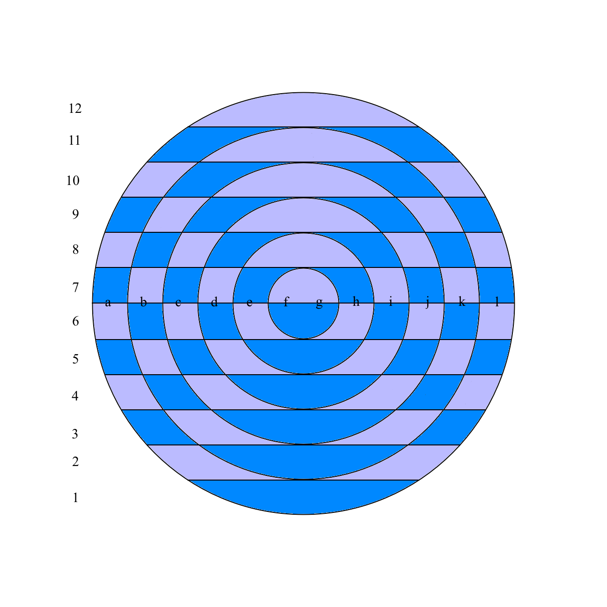
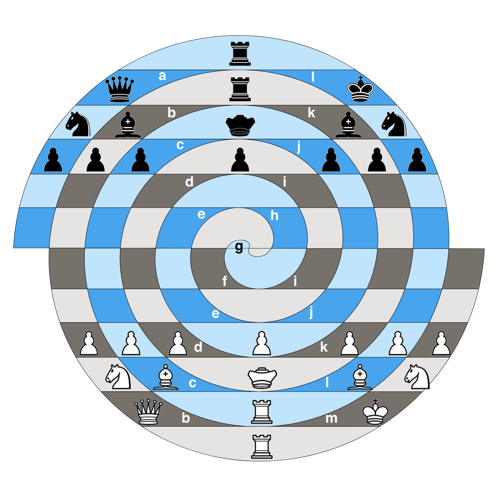
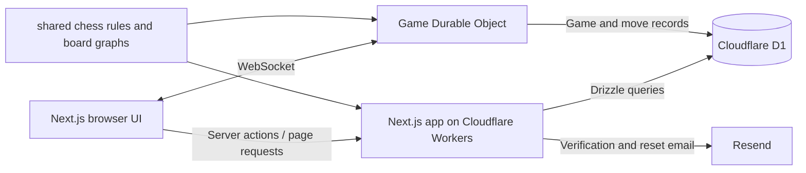

# Concentric Chess

Concentric Chess is a browser based multiplayer chess platform for two original board variants: **Concentric Chess**, played on 72 cells arranged in rings, and **Archimedean Chess**, played on a spiral board. Create an account to play online, challenge another player, join matchmaking, or start a local game.

**Live demo:** [capstone.mrvillage.dev](https://capstone.mrvillage.dev/)

## Screenshots

| Concentric board | Archimedean board |
| --- | --- |
|  |  |

## Features

- Two chess variants with their own board geometry, rules, and pieces, including the Prince and variant-specific pawn movement.
- Online matchmaking and direct player challenges, plus local two-sided games.
- Rapid (10 minute), blitz (3 minute), bullet (1 minute), and unlimited time controls.
- Live game updates over WebSockets, with server-side legal move checks, clocks, resignation, draw offers, and disconnect handling.
- Game history and move-by-move replay.
- Accounts with email verification, password reset, and configurable move confirmation.
- Rules pages for both variants.

Online play requires a signed-in account with a verified email address. Local games also require an account.

## Technology

- **Next.js 15, React 19, TypeScript** — application routes, server-rendered pages, server actions, and interactive UI.
- **Tailwind CSS 4, Radix UI, shadcn-style components** — styling and accessible UI primitives.
- **Cloudflare Workers and OpenNext** — deployment runtime for the Next.js application.
- **Cloudflare D1 and Drizzle ORM** — SQLite-compatible relational storage and typed queries.
- **Cloudflare Durable Objects and WebSockets** — per-game live connections and game event processing.
- **Resend** — email verification and password-reset messages.
- **Vitest, Testing Library, Cypress** — unit/component, Durable Object, and browser end-to-end test suites.

## Architecture



The Next.js app handles navigation, account flows, game creation, and initial page data. Game actions pass through a Durable Object for that game; it checks moves against the shared rules and persists game state and moves in D1. The `shared` package contains the schema, board graphs, move logic, and WebSocket message types used across the app and game worker.

## Repository layout

```text
src/app/             Next.js pages, route handlers, and server actions
src/components/      Application UI, chess board, and reusable components
src/lib/             Database, authentication, email, invites, and WebSocket client
shared/              Database schema, game rules, board graphs, and shared types
do/                  Cloudflare Durable Object worker and its tests
migrations/          D1 SQL migrations
cypress/e2e/         Browser end-to-end tests
public/              Board diagrams, chess pieces, and static assets
scripts/             Board asset generation utilities
concentric-graph/    Rust utility and generated graph data
```

## Prerequisites

- Node.js 20 or newer and npm.
- A Cloudflare account is only needed for deployment. Local development uses Wrangler's local D1 and Durable Object emulation.
- A Resend API key is optional for local development; without it, email sends are skipped with a warning.

## Local development

Install dependencies in the application and Durable Object worker:

```bash
npm ci
cd do && npm ci && cd ..
```

Create the local variables file:

```bash
cp .dev.vars.example .dev.vars
```

Set `RESEND_API_KEY` in `.dev.vars` to a valid Resend key if you want to exercise email verification or password reset. The value in the example file is a placeholder, not a working credential.

Apply D1 migrations and start both development servers in separate terminals from the repository root:

```bash
npx wrangler d1 migrations apply capstone --local
npm run dev
```

```bash
cd do
npx wrangler dev --local --persist-to ../.wrangler/state
```

Then open [http://localhost:3000](http://localhost:3000). The app's WebSocket and matchmaking requests use the local Durable Object worker at port `8787`.

## Commands

| Command | Purpose |
| --- | --- |
| `npm run dev` | Start the Next.js development server. |
| `npm run build` | Build the Next.js app. |
| `npm run lint` | Run the configured Next.js ESLint command. |
| `npm run test` | Start the root Vitest suite. Add `-- --run` for a one-shot run. |
| `npm run test:do` | Run Durable Object tests in `do/`. |
| `npm run cypress:open` | Open the Cypress end-to-end test runner. |
| `npm run cypress:run` | Run Cypress end-to-end tests headlessly. |
| `npm run preview` | Build and preview the Cloudflare deployment locally. |
| `npm run deploy` | Build and deploy the Next.js app through OpenNext. |

For browser tests, start both local development servers before opening or running Cypress.

## Environment and deployment

| Variable / binding | Purpose |
| --- | --- |
| `RESEND_API_KEY` | Optional locally; required as a Cloudflare Worker secret to send verification and reset emails in production. |
| `DB` | Cloudflare D1 binding configured in `wrangler.jsonc` and `do/wrangler.jsonc`. |
| `GAME_OBJECT` | Durable Object namespace binding configured for the app worker. |

The root `wrangler.jsonc` defines the app's D1 binding, custom domain, assets, and Durable Object binding. The separate `do/wrangler.jsonc` config defines the `capstone-do` worker and its D1/DO bindings. Apply migrations to the appropriate D1 database before deploying. Configure `RESEND_API_KEY` with Wrangler's secret management for production; do not commit real credentials.

The repository includes `npm run deploy` for the OpenNext app and a separate Wrangler config for the game worker. Deploy the `do/` worker separately with Wrangler when publishing changes to Durable Object code.

## Testing

The repository has root Vitest tests for shared rules, libraries, server actions, and React components; a separate Vitest Workers-pool suite for Durable Object behavior; and Cypress browser tests for authentication, navigation, settings, game boards, and the play lobby. Test commands are listed above. No test or coverage result is implied by this documentation.

## Future improvements

- Add CI checks for type checking, linting, unit tests, and production builds.
- Strengthen transactional guarantees and message validation around concurrent game updates.
- Add automated accessibility checks and broader keyboard/screen-reader support for the board.
